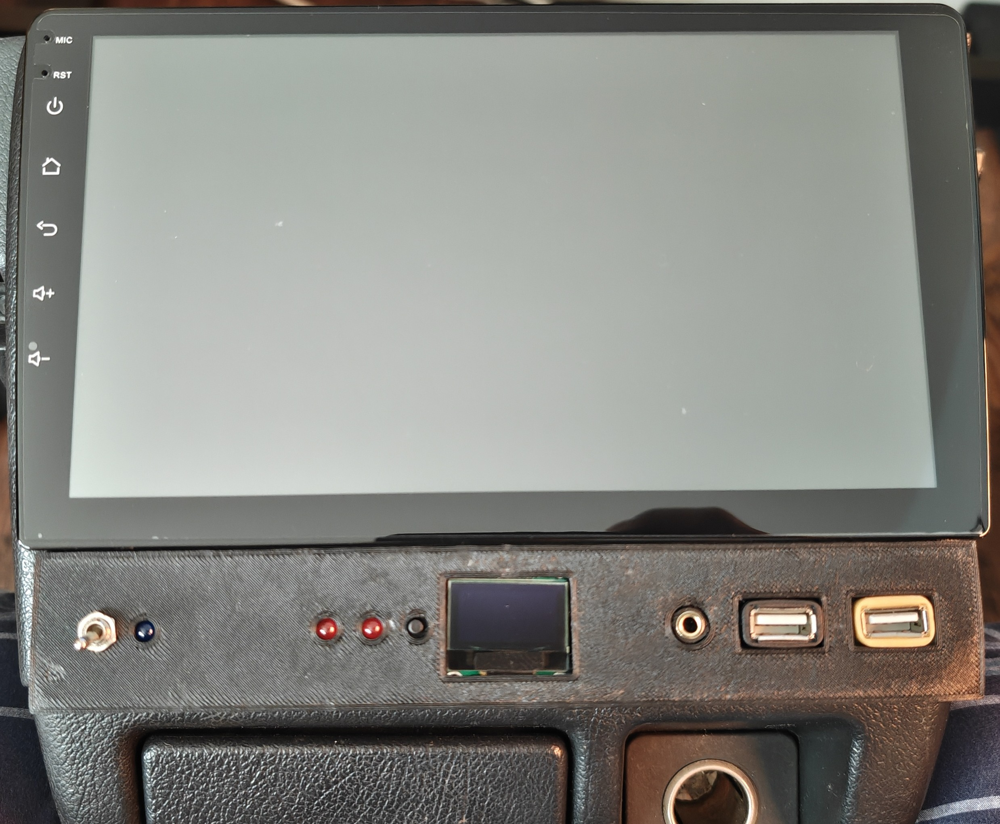

# Civic-Dashbar

An Arduino Nano–based mini digital dash for monitoring **system voltage** and **coolant temperature** in a vehicle, originally built for a 1990 Honda Civic EF.

## Preview

## What this project does

The firmware in [`/CivicEF-DashBar/CivicEF-DashBar.ino`](./CivicEF-DashBar/CivicEF-DashBar.ino) drives a 128x64 SSD1306 OLED over I2C and continuously reads:

- **A1** for vehicle electrical system voltage (through a resistor divider)
- **A0** for coolant temperature sender signal (mapped to °F using calibration points)

It displays both values on screen with an engine monitor layout and includes:

- A startup boot logo
- A pushbutton display toggle (data screen ↔ logo screen)
- LED warning outputs for low voltage and high coolant temp

## Hardware / wiring (from the Arduino code)

### OLED (SSD1306 I2C)
- SDA → **A4**
- SCL → **A5**
- VCC → **5V**
- GND → **GND**

### Inputs
- **Vehicle 12V monitoring**: `Car 12V -> 100k -> A1`, with `33k -> GND` divider leg  
- **Coolant sender signal**: `Temp Signal -> 100k -> A0`, with `0.1uF -> GND` filter

### Other pins
- **D4**: button input (display mode toggle)
- **D2**: high coolant warning LED output (turns on at ~215°F)
- **D3**: low voltage warning LED output (turns on at ≤12V)

## Coolant temperature calibration

The code uses two calibration points to estimate coolant temperature:

- `CLT_RAW_COLD` / `CLT_F_COLD`
- `CLT_RAW_HOT` / `CLT_F_HOT`

Update these constants in the `.ino` file using your own measured readings for your sensor and vehicle.

## Notes

- Designed around a Civic EF sender/gauge behavior where ADC raw value decreases as temp increases.
- Can be adapted to other vehicles by changing the calibration and, if needed, resistor scaling.
